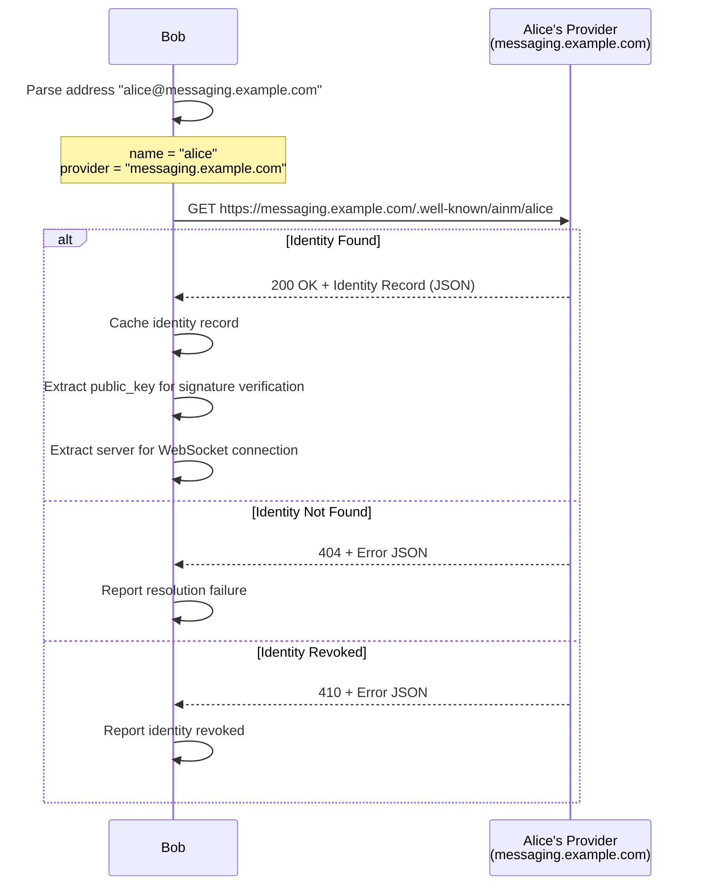

# Identity Specification

**Status:** Draft
**Version:** 0.1.0
**Last Updated:** 2026-03-28

## 1. Overview

Every participant in the AI-Native Messaging (AINM) protocol -- whether a human user or an AI agent -- has a unique identity represented by an address. This address is the foundation of the protocol: it appears in message envelopes as the sender, in thread participant lists, in presence updates, and in cryptographic signatures. Without identity, there is no trust and no routing.

Identity in AINM follows an email-like model: `name@provider`. The provider is responsible for hosting the participant's public key, routing messages to their home server, and managing key rotation. This is deliberately familiar -- anyone who understands email addresses can understand AINM addresses. Federation works the same way: providers are independent servers that communicate with each other, and no single provider controls the network.

A core design principle of AINM is **uniform addressing** -- the protocol treats human and agent participants equally. There is no syntactic distinction between a human address and an agent address. The address `alice@messaging.example.com` and `weather-bot@agents.example.com` follow identical formats and are resolved through identical mechanisms. The participant's type (human or agent) is metadata, not part of the address structure. This ensures that any protocol operation that works for a human also works for an agent, and vice versa.

## 2. Terminology

| Term | Definition |
|------|-----------|
| **Identity** | The combination of an address, a cryptographic key pair, and metadata that uniquely represents a participant in the protocol. |
| **Address** | A string in the format `name@provider` that uniquely identifies a participant. Used in message envelopes, thread participant lists, and presence. |
| **Provider** | A domain that hosts identity records and manages the namespace for participants under that domain. Analogous to an email provider. |
| **Participant** | Any entity (human or agent) that holds an identity and can send or receive messages in the protocol. |
| **Key Pair** | An Ed25519 key pair (private key + public key) bound to an identity. The private key signs messages; the public key is published for verification. |
| **Key Rotation** | The process of replacing a participant's active key pair with a new one while preserving the ability to verify messages signed with the previous key. |
| **Identity Record** | The JSON document returned by a provider when an identity is resolved. Contains the participant's public key, home server, type, and key history. |
| **Home Server** | The WebSocket server where a participant connects to send and receive messages. Specified in the identity record's `server` field. |

## 3. Address Format

### 3.1 Structure

An AINM address consists of two parts separated by the `@` character:

```
name@provider
```

- **`name`**: The local identifier within the provider's namespace.
- **`provider`**: A valid domain name identifying the hosting provider.

**Example:**

```json
{
  "input": "alice@messaging.example.com",
  "parsed": {
    "name": "alice",
    "provider": "messaging.example.com"
  }
}
```

### 3.2 Name Rules

The `name` component:

- MUST begin with an ASCII alphanumeric character (`a-z`, `A-Z`, `0-9`).
- MAY contain ASCII alphanumeric characters, periods (`.`), underscores (`_`), and hyphens (`-`).
- MUST be between 1 and 64 characters in length.
- MUST be treated as case-insensitive. Implementations MUST normalize names to lowercase before comparison or storage.

**Regex (per-component):**

```
^[a-zA-Z0-9][a-zA-Z0-9._-]{0,63}$
```

Valid examples: `alice`, `weather-bot`, `agent.v2`, `Bob_Smith`, `a`

Invalid examples: `-alice` (starts with hyphen), `.hidden` (starts with period), `_under` (starts with underscore), `` (empty string), a string of 65+ characters

### 3.3 Provider Rules

The `provider` component:

- MUST be a valid domain name per RFC 1035.
- MUST contain at least one period (`.`) separating labels, except for `localhost` in development environments.
- Each label MUST begin and end with an alphanumeric character and MAY contain hyphens.

### 3.4 Full Address Regex

The complete address validation regex:

```
^[a-zA-Z0-9][a-zA-Z0-9._-]{0,63}@[a-zA-Z0-9]([a-zA-Z0-9-]*[a-zA-Z0-9])?(\.[a-zA-Z0-9]([a-zA-Z0-9-]*[a-zA-Z0-9])?)*$
```

### 3.5 Uniform Addressing

There is no syntactic distinction between human and agent addresses. Both `alice@messaging.example.com` (a human) and `weather-bot@agents.example.com` (an agent) use the identical format. The participant type is conveyed in the identity record metadata (see Section 4), not in the address itself.

This uniformity means that any protocol operation -- sending a message, adding to a thread, resolving identity, verifying a signature -- works identically regardless of whether the target is a human or an agent.

## 4. Identity Resolution

Identity resolution is the process of looking up a participant's public key, home server, and metadata given their address. This is the mechanism by which one participant discovers how to communicate with another.

### 4.1 Resolution Endpoint

To resolve an identity, construct an HTTPS URL from the address components and issue a GET request:

```
GET https://{provider}/.well-known/ainm/{name}
```

- The connection MUST use TLS 1.3 or higher. Implementations MUST reject connections over plain HTTP.
- The response Content-Type MUST be `application/json`.

**Example request:**

```
GET https://agents.example.com/.well-known/ainm/weather-bot HTTP/1.1
Host: agents.example.com
Accept: application/json
```

### 4.2 Response Format

A successful resolution returns a flat JSON object -- the **identity record** -- with the following fields:

```json
{
  "id": "weather-bot@agents.example.com",
  "public_key": "MCowBQYDK2VwAyEA6bR-Y57oVDQrVixqH_Zt6eGbamVR1N3gILEf0nG1I3U",
  "server": "wss://agents.example.com/ainm/v1",
  "type": "agent",
  "agent_card_url": "https://agents.example.com/.well-known/agent-card.json",
  "key_history": []
}
```

### 4.3 Field Definitions

| Field | Type | Required | Description |
|-------|------|----------|-------------|
| `id` | string | REQUIRED | The full AINM address. MUST exactly match `{name}@{provider}` from the request URL. |
| `public_key` | string | REQUIRED | The participant's current Ed25519 public key, base64url-encoded without padding (RFC 4648 Section 5). The raw key is 32 bytes. |
| `server` | string | REQUIRED | The WebSocket endpoint URL for the participant's home server. MUST use the `wss://` scheme. |
| `type` | string | REQUIRED | The participant type: `"human"` or `"agent"`. The protocol treats both equally; clients MAY use this field to adapt UI presentation (e.g., different presence semantics, capability indicators). |
| `agent_card_url` | string | OPTIONAL | URL to an A2A-compatible Agent Card (JSON). Present when `type` is `"agent"`. Omitted when `type` is `"human"`. Clients MAY fetch this to discover agent capabilities. |
| `key_history` | array | REQUIRED | An array of previous key records, ordered from most recent to oldest. May be empty if the participant has never rotated keys. See Section 6 for the key history record structure. |

### 4.4 Public Key Encoding

Public keys in AINM use **base64url encoding without padding** as defined in RFC 4648 Section 5:

- The standard Base64 alphabet is modified: `+` becomes `-`, `/` becomes `_`.
- Trailing `=` padding characters are omitted.
- The raw Ed25519 public key is exactly 32 bytes, producing a 43-character base64url string.

**Example:**

| Representation | Value |
|---------------|-------|
| Raw bytes (hex) | `e9b47e639ee854342b56ac6a1ff66de9e19b6a6551d4dde020b11fd271b52375` |
| Base64url (no padding) | `6bR-Y57oVDQrVixqH_Zt6eGbamVR1N3gILEf0nG1I3U` |

### 4.5 Identity Resolution for Humans

A human identity record omits the `agent_card_url` field:

```json
{
  "id": "alice@messaging.example.com",
  "public_key": "kRzL7Phn2M3oaFm9GQ2JLKOO-NRxiH8xq7Xz1a3Wnxg",
  "server": "wss://messaging.example.com/ainm/v1",
  "type": "human",
  "key_history": []
}
```

### 4.6 Error Responses

When identity resolution fails, the server returns an HTTP error status code with a JSON error body following the JSON-RPC error format:

**404 -- Identity Not Found:**

```json
{
  "error": {
    "code": -32001,
    "message": "Identity not found"
  }
}
```

**410 -- Identity Deleted or Revoked:**

```json
{
  "error": {
    "code": -32002,
    "message": "Identity has been revoked"
  }
}
```

**429 -- Rate Limited:**

```json
{
  "error": {
    "code": -32003,
    "message": "Too many requests. Retry after 60 seconds.",
    "data": {
      "retry_after": 60
    }
  }
}
```

### 4.7 Caching

Providers SHOULD set `Cache-Control` headers on successful identity resolution responses. Clients MUST respect cache directives when present.

Recommended caching behavior:

- Active identities: `Cache-Control: public, max-age=3600` (1 hour)
- After key rotation: the cache for the rotated identity SHOULD be invalidated immediately by the provider
- Error responses (404, 410): `Cache-Control: public, max-age=300` (5 minutes)

Clients SHOULD cache resolved identity records locally and refresh them when:
- The cached record's TTL expires
- A signature verification fails with the cached public key (may indicate key rotation)
- A connection to the participant's home server fails

## 5. Identity Registration

Registration is the process by which a new participant creates an identity with a provider. The participant generates an Ed25519 key pair locally, then submits the public key to the provider along with their desired name.

### 5.1 Registration Endpoint

```
POST https://{provider}/.well-known/ainm/register
```

The connection MUST use TLS 1.3 or higher.

### 5.2 Request Format

```json
{
  "name": "alice",
  "public_key": "kRzL7Phn2M3oaFm9GQ2JLKOO-NRxiH8xq7Xz1a3Wnxg",
  "type": "human"
}
```

| Field | Type | Required | Description |
|-------|------|----------|-------------|
| `name` | string | REQUIRED | Desired name. MUST conform to the name rules in Section 3.2. |
| `public_key` | string | REQUIRED | Ed25519 public key, base64url-encoded without padding. |
| `type` | string | REQUIRED | Participant type: `"human"` or `"agent"`. |

### 5.3 Successful Response

HTTP 201 Created with the full identity record:

```json
{
  "id": "alice@messaging.example.com",
  "public_key": "kRzL7Phn2M3oaFm9GQ2JLKOO-NRxiH8xq7Xz1a3Wnxg",
  "server": "wss://messaging.example.com/ainm/v1",
  "type": "human",
  "key_history": []
}
```

The `server` field is assigned by the provider and indicates where the participant should connect.

### 5.4 Error Responses

**409 -- Name Already Taken:**

```json
{
  "error": {
    "code": -32004,
    "message": "Name 'alice' is already registered"
  }
}
```

**400 -- Invalid Request:**

```json
{
  "error": {
    "code": -32005,
    "message": "Invalid public key format: expected 32-byte Ed25519 key, base64url-encoded"
  }
}
```

```json
{
  "error": {
    "code": -32006,
    "message": "Invalid name: must match ^[a-zA-Z0-9][a-zA-Z0-9._-]{0,63}$"
  }
}
```

### 5.5 Registration Notes

- Registration does NOT include domain verification in v1. Providers manage their own namespace and are responsible for preventing abuse.
- Providers MAY require additional authentication or verification steps beyond what this specification defines (e.g., email verification, CAPTCHA, API keys). Such mechanisms are out of scope for the protocol specification.
- A single provider MAY host both human and agent identities.
- The participant's private key MUST never be transmitted to the provider. Only the public key is submitted during registration.

## 6. Key Rotation

Key rotation allows a participant to replace their active Ed25519 key pair with a new one. This is essential for security hygiene (periodic rotation), incident response (compromised key), and operational needs (device migration).

### 6.1 Rotation Endpoint

```
POST https://{provider}/.well-known/ainm/{name}/rotate
```

The connection MUST use TLS 1.3 or higher.

### 6.2 Request Format

The participant submits their new public key along with a proof of ownership -- a signature of the new public key made with the current (old) private key:

```json
{
  "new_public_key": "Xk9pO2jH5sQrN7vB3mD1wYfA8cLiE4gK6tU0nR9zJxM",
  "proof": "rFm2KjY9vB0pN3sD7xHqW1cLgZ5tA8eU6iR4oJnMwXfTbPy-QlVkC2dSaGhIuOEz"
}
```

| Field | Type | Required | Description |
|-------|------|----------|-------------|
| `new_public_key` | string | REQUIRED | The new Ed25519 public key, base64url-encoded without padding. |
| `proof` | string | REQUIRED | Base64url-encoded Ed25519 signature of the raw bytes of `new_public_key` (the base64url string encoded as UTF-8 bytes), signed with the participant's current private key. This proves the rotation request comes from the legitimate key holder. |

### 6.3 Server Behavior on Rotation

When a provider receives a valid rotation request:

1. Verify the `proof` signature using the participant's current public key.
2. Move the current public key to the `key_history` array with `valid_until` set to the current UTC timestamp.
3. Set `valid_from` on the historical record to the time the key was originally activated.
4. Set `revocation_reason` to `"scheduled_rotation"` (or the appropriate reason if provided).
5. Install the `new_public_key` as the participant's current public key.

### 6.4 Successful Response

HTTP 200 OK with the updated identity record:

```json
{
  "id": "alice@messaging.example.com",
  "public_key": "Xk9pO2jH5sQrN7vB3mD1wYfA8cLiE4gK6tU0nR9zJxM",
  "server": "wss://messaging.example.com/ainm/v1",
  "type": "human",
  "key_history": [
    {
      "public_key": "kRzL7Phn2M3oaFm9GQ2JLKOO-NRxiH8xq7Xz1a3Wnxg",
      "valid_from": "2026-01-15T10:00:00Z",
      "valid_until": "2026-03-28T14:30:00Z",
      "revocation_reason": "scheduled_rotation"
    }
  ]
}
```

### 6.5 Key History Record

Each entry in the `key_history` array has the following structure:

```json
{
  "public_key": "kRzL7Phn2M3oaFm9GQ2JLKOO-NRxiH8xq7Xz1a3Wnxg",
  "valid_from": "2026-01-15T10:00:00Z",
  "valid_until": "2026-03-28T14:30:00Z",
  "revocation_reason": "scheduled_rotation"
}
```

| Field | Type | Required | Description |
|-------|------|----------|-------------|
| `public_key` | string | REQUIRED | The historical Ed25519 public key, base64url-encoded without padding. |
| `valid_from` | string | REQUIRED | RFC 3339 timestamp (UTC) when this key was activated. |
| `valid_until` | string | REQUIRED | RFC 3339 timestamp (UTC) when this key was replaced. |
| `revocation_reason` | string | REQUIRED | Reason for rotation. One of: `"scheduled_rotation"`, `"compromised"`, `"administrative"`. |

**Revocation reasons:**

| Reason | Meaning | Implication |
|--------|---------|-------------|
| `scheduled_rotation` | Routine key rotation for security hygiene. | Messages signed with this key during its validity period are trustworthy. |
| `compromised` | The private key was exposed or suspected of exposure. | Messages signed with this key SHOULD be treated as potentially forged. Recipients MAY display a warning. |
| `administrative` | Provider-initiated rotation (e.g., account recovery, policy enforcement). | Messages signed with this key during its validity period are trustworthy. |

### 6.6 Overlap Period

After key rotation, the old key remains valid **for signature verification only** (not for signing new messages) for a grace period of 24 hours. This accounts for:

- Messages that were in transit at the time of rotation
- Caching delays where recipients may not have fetched the updated identity record yet
- Clock skew between participants

After the 24-hour overlap period, the old key's validity is determined solely by its `valid_from` and `valid_until` timestamps in the key history.

### 6.7 Verification with Historical Keys

When verifying a message signature:

1. Try the participant's **current** public key first.
2. If verification fails, check the message's `timestamp` field.
3. Search the `key_history` array for a key whose `valid_from` <= message `timestamp` <= `valid_until` (plus the 24-hour overlap period).
4. If a matching historical key is found, verify the signature with that key.
5. If no matching key is found or verification fails with all candidate keys, reject the message.

This procedure is detailed in `security.md` Section 5 (Verification Procedure).

### 6.8 Key History Retention

Providers SHOULD retain key history records for at least 1 year. This ensures that messages signed with older keys remain verifiable for a reasonable period. Providers MAY retain history longer, and SHOULD communicate their retention policy in their service documentation.

### 6.9 Rotation Error Responses

**401 -- Invalid Proof:**

```json
{
  "error": {
    "code": -32007,
    "message": "Proof signature verification failed"
  }
}
```

**400 -- Invalid Key:**

```json
{
  "error": {
    "code": -32005,
    "message": "Invalid public key format: expected 32-byte Ed25519 key, base64url-encoded"
  }
}
```

## 7. Security Considerations

### 7.1 Provider Trust

Providers are trusted to accurately associate public keys with identities. A malicious or compromised provider could serve incorrect public keys, enabling impersonation. This is analogous to the trust placed in DNS and certificate authorities in the TLS ecosystem.

Mitigations for future protocol versions may include key pinning, transparency logs, or multi-provider key verification. These are out of scope for v1.

### 7.2 Key Compromise Response

If a participant's private key is compromised:

1. The participant SHOULD immediately rotate their key using the rotation endpoint with `revocation_reason` set to `"compromised"`.
2. Recipients who resolve the updated identity will see the `"compromised"` reason in the key history and SHOULD treat messages signed with that key as potentially forged.
3. If the participant can no longer prove ownership (the attacker has the private key), the provider MUST provide an out-of-band recovery mechanism. Such mechanisms are provider-specific and out of scope for this specification.

### 7.3 Address Enumeration

Providers MAY rate-limit identity resolution requests to prevent mass enumeration of registered identities. The recommended approach is to return HTTP 429 (Too Many Requests) with a `Retry-After` header.

Providers SHOULD NOT provide a "list all identities" endpoint. Discovery of participants should happen through social channels, agent directories, or Agent Card discovery -- not by enumerating a provider's namespace.

### 7.4 TLS Requirement

All identity resolution and registration endpoints MUST be served over HTTPS with TLS 1.3 or higher. Clients MUST reject connections over plain HTTP, even if the server responds. This prevents man-in-the-middle attacks that could substitute public keys during resolution.

### 7.5 Name Squatting

Providers are responsible for their own namespace management. The protocol does not define anti-squatting measures. Providers MAY implement their own policies (e.g., reserved names, verification requirements, reclamation procedures).

## 8. Examples

### 8.1 End-to-End Flow: Register, Resolve, Connect

This example shows the complete flow from identity creation to establishing communication.

**Step 1: Alice generates a key pair locally**

```
Private key (kept secret): kQm7L9pN2xR5vB0sD3fH6jY8tA1eU4iG
Public key: kRzL7Phn2M3oaFm9GQ2JLKOO-NRxiH8xq7Xz1a3Wnxg
```

**Step 2: Alice registers with her provider**

```
POST https://messaging.example.com/.well-known/ainm/register
Content-Type: application/json

{
  "name": "alice",
  "public_key": "kRzL7Phn2M3oaFm9GQ2JLKOO-NRxiH8xq7Xz1a3Wnxg",
  "type": "human"
}
```

Response (201 Created):

```json
{
  "id": "alice@messaging.example.com",
  "public_key": "kRzL7Phn2M3oaFm9GQ2JLKOO-NRxiH8xq7Xz1a3Wnxg",
  "server": "wss://messaging.example.com/ainm/v1",
  "type": "human",
  "key_history": []
}
```

**Step 3: Bob wants to message Alice -- resolves her identity**

```
GET https://messaging.example.com/.well-known/ainm/alice
Accept: application/json
```

Response (200 OK):

```json
{
  "id": "alice@messaging.example.com",
  "public_key": "kRzL7Phn2M3oaFm9GQ2JLKOO-NRxiH8xq7Xz1a3Wnxg",
  "server": "wss://messaging.example.com/ainm/v1",
  "type": "human",
  "key_history": []
}
```

**Step 4: Bob caches Alice's identity and connects to her home server**

Bob now has Alice's public key for signature verification and her server address for message delivery.

### 8.2 Key Rotation Flow

**Step 1: Alice generates a new key pair**

```
New private key (kept secret): nW8xR3pK5vB0mD7fH2jY9tQ1eU6iL4gS
New public key: Xk9pO2jH5sQrN7vB3mD1wYfA8cLiE4gK6tU0nR9zJxM
```

**Step 2: Alice signs the new public key with her current private key**

Alice creates a proof by signing the UTF-8 bytes of the base64url-encoded new public key string using her current private key.

**Step 3: Alice submits the rotation request**

```
POST https://messaging.example.com/.well-known/ainm/alice/rotate
Content-Type: application/json

{
  "new_public_key": "Xk9pO2jH5sQrN7vB3mD1wYfA8cLiE4gK6tU0nR9zJxM",
  "proof": "rFm2KjY9vB0pN3sD7xHqW1cLgZ5tA8eU6iR4oJnMwXfTbPy-QlVkC2dSaGhIuOEz"
}
```

Response (200 OK):

```json
{
  "id": "alice@messaging.example.com",
  "public_key": "Xk9pO2jH5sQrN7vB3mD1wYfA8cLiE4gK6tU0nR9zJxM",
  "server": "wss://messaging.example.com/ainm/v1",
  "type": "human",
  "key_history": [
    {
      "public_key": "kRzL7Phn2M3oaFm9GQ2JLKOO-NRxiH8xq7Xz1a3Wnxg",
      "valid_from": "2026-01-15T10:00:00Z",
      "valid_until": "2026-03-28T14:30:00Z",
      "revocation_reason": "scheduled_rotation"
    }
  ]
}
```

**Step 4: Verifying a message signed with the old key**

Bob receives a message from Alice with `timestamp: "2026-03-28T14:00:00Z"` -- 30 minutes before the rotation. Bob's cached identity record has the new key. Verification with the new key fails, so Bob checks the key history: the old key was valid from `2026-01-15` to `2026-03-28T14:30:00Z`. The message timestamp `14:00:00` falls within this range. Bob verifies the signature with the historical key -- it succeeds.

### 8.3 Identity Resolution Sequence Diagram



## References

- **RFC 8032** -- Edwards-Curve Digital Signature Algorithm (Ed25519)
- **RFC 4648** -- The Base16, Base32, and Base64 Data Encodings (Section 5: base64url)
- **RFC 1035** -- Domain Names - Implementation and Specification
- **RFC 8615** -- Well-Known Uniform Resource Identifiers
- **RFC 3339** -- Date and Time on the Internet: Timestamps
- **AINM Security Specification** (`security.md`) -- Message signing and verification procedures using the identity and key data defined here
