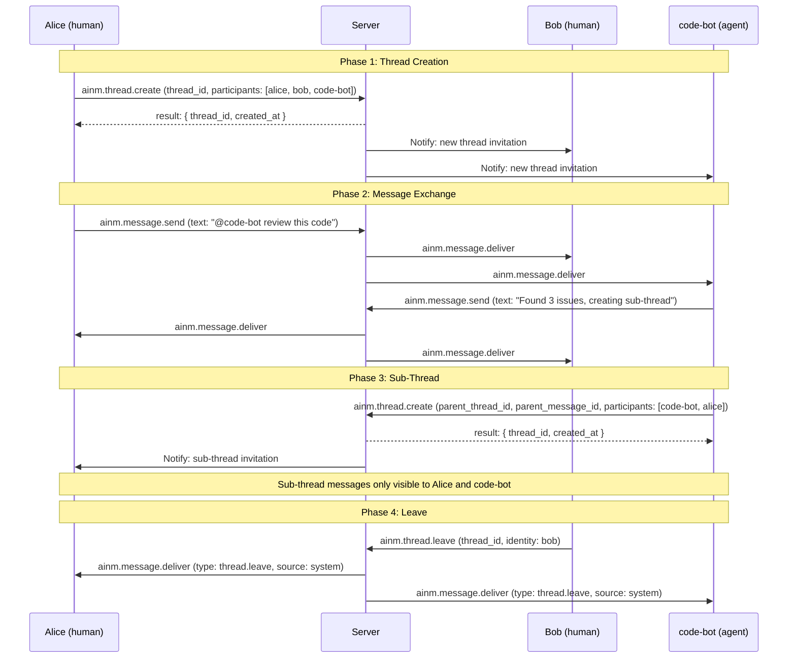
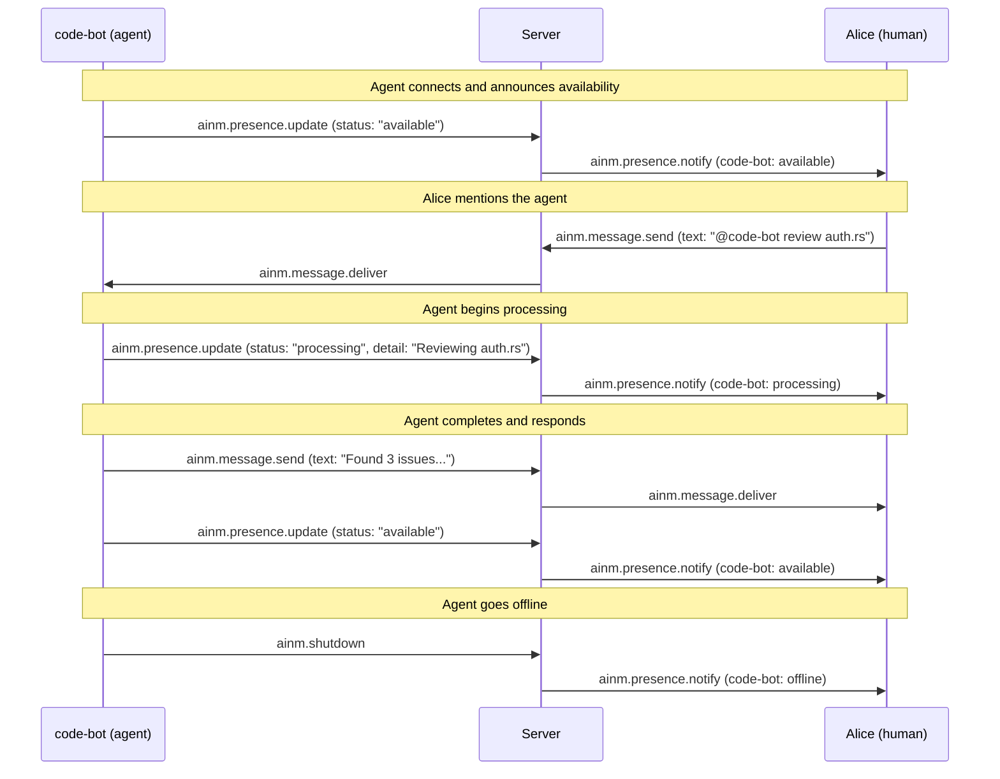

# Threading Specification

**AI-Native Messaging Protocol (AINM) -- Version 0.1.0**

## 1. Overview

Threads are the organizational unit of conversation in the AI-Native Messaging Protocol. A thread is a chronologically-ordered stream of messages shared among a set of participants. Every message in AINM belongs to exactly one thread, identified by the message's `thread_id` field (see security.md Section 3.2). Threads are how participants -- humans and agents alike -- organize their communication into distinct, manageable conversations.

The threading model is designed around three principles: **flat by default**, **one level of sub-threading**, and **mixed human-agent participation as equals**. Conversations within a thread are flat -- messages form a single chronological sequence with no implicit nesting or reply chains. When a focused side-conversation is needed, any participant can branch a sub-thread from a specific message. Sub-threads are limited to one level of nesting: you can create a sub-thread from a root thread, but you cannot create a sub-thread from a sub-thread. This constraint keeps the threading model simple and prevents the complexity explosion that plagues deeply-nested conversation systems.

This specification builds on four prior AINM specifications. Participants are identified by AINM addresses and their type (human or agent) is resolved through the identity system defined in identity.md. Messages within threads are cryptographically signed per security.md. Message content uses the typed content block system defined in content.md, including the TextBlock `mentions` array for @-mention annotations. Thread operations (`ainm.thread.create`, `ainm.thread.join`, `ainm.thread.leave`) and presence methods (`ainm.presence.update`, `ainm.presence.notify`) are transmitted via the JSON-RPC methods defined in transport.md.

## 2. Terminology

| Term | Definition |
|------|-----------|
| **Thread** | A chronologically-ordered stream of messages identified by a `thread_id` (UUIDv7). Threads contain messages and have a participant list. |
| **Root thread** | A top-level thread with no parent. The `parent_thread_id` and `parent_message_id` fields are `null`. |
| **Sub-thread** | A thread created from a specific message in a parent root thread. Has non-null `parent_thread_id` and `parent_message_id` fields. Sub-threads are limited to one level of nesting. |
| **Participant** | A human or agent identity that is a member of a thread and can send and receive messages within it. Identified by an AINM address (`name@provider`). |
| **Thread creator** | The participant who created the thread via `ainm.thread.create`. Assigned the `"creator"` role. Each thread has exactly one creator. |
| **Parent thread** | The root thread from which a sub-thread was branched. Referenced by `parent_thread_id`. |
| **Parent message** | The specific message in the parent thread from which a sub-thread was branched. Referenced by `parent_message_id`. |
| **Context inheritance** | The set of data and state that a sub-thread receives from its parent thread at creation time. AINM uses minimal inheritance -- sub-threads do not automatically receive parent messages or presence state. |
| **Presence** | A participant's current status within a thread (e.g., online, processing). Presence is thread-scoped -- a participant has independent presence in each thread they belong to. |
| **Mention** | An @-reference to a participant within a TextBlock's `mentions` array (defined in content.md). Mentions work uniformly across human and agent participants. |

## 3. Thread Model (THRD-01)

A thread is a chronologically-ordered stream of messages identified by a `thread_id`. The `thread_id` is a UUIDv7 (RFC 9562), which provides time-ordering for natural chronological sorting.

### 3.1 Flat Conversations

Conversations within a thread are flat by default. Messages form a single, chronological sequence -- there are no reply chains, nested replies, or implicit threading within a thread. Every message in a thread is visible to every participant in that thread, delivered in the order received by the server.

This design mirrors how real conversations work: people (and agents) talk in sequence, and everyone in the room hears everything. When a focused side-conversation is needed, participants create an explicit sub-thread (Section 4) rather than nesting replies within the main thread.

### 3.2 Thread-Addressed Delivery

Messages are sent TO a `thread_id`, not to individual participants. When a participant sends a message via `ainm.message.send` (transport.md Section 4.4), the server delivers the message to all other participants in the thread via `ainm.message.deliver`. This is thread-addressed delivery (D-11 from the protocol design decisions).

DMs (direct messages) are threads with exactly two participants. There is no special-casing for DMs at the protocol level -- they are ordinary threads that happen to have a participant count of two.

### 3.3 Thread Metadata

Every thread carries the following metadata structure:

```json
{
  "thread_id": "019580a0-1234-7000-8000-000000000001",
  "title": "Project discussion",
  "created_at": "2026-03-28T12:00:00.000Z",
  "created_by": "alice@messaging.example.com",
  "parent_thread_id": null,
  "parent_message_id": null,
  "participants": [
    {
      "identity": "alice@messaging.example.com",
      "type": "human",
      "joined_at": "2026-03-28T12:00:00.000Z",
      "role": "creator"
    },
    {
      "identity": "code-bot@agents.example.com",
      "type": "agent",
      "joined_at": "2026-03-28T12:00:05.000Z",
      "role": "member"
    }
  ]
}
```

**Field definitions:**

| Field | Type | Required | Description |
|-------|------|----------|-------------|
| `thread_id` | string | REQUIRED | UUIDv7 identifying the thread. Generated client-side by the creator. Server validates uniqueness. |
| `title` | string | OPTIONAL | Human-readable thread title. Informational only -- not used for routing or identification. |
| `created_at` | string | REQUIRED | RFC 3339 timestamp (UTC) of when the thread was created. Set by the server upon successful `ainm.thread.create`. |
| `created_by` | string | REQUIRED | AINM address of the thread creator. |
| `parent_thread_id` | string or null | REQUIRED | UUIDv7 of the parent thread. `null` for root threads. Non-null for sub-threads. |
| `parent_message_id` | string or null | REQUIRED | UUIDv7 of the parent message from which this sub-thread branches. `null` for root threads. Non-null for sub-threads. |
| `participants` | array | REQUIRED | Array of participant records. Each record includes `identity`, `type`, `joined_at`, and `role`. |

**Participant record fields:**

| Field | Type | Description |
|-------|------|-------------|
| `identity` | string | The participant's AINM address (e.g., `alice@messaging.example.com`). |
| `type` | string | The participant's type: `"human"` or `"agent"`. Resolved from the identity record (identity.md Section 4.3). |
| `joined_at` | string | RFC 3339 timestamp (UTC) of when the participant joined the thread. |
| `role` | string | Either `"creator"` (the thread creator, exactly one per thread) or `"member"` (all other participants). Both roles have equal messaging capabilities -- role is informational only. |

### 3.4 Thread Creation

Thread creation uses the `ainm.thread.create` method defined in transport.md Section 4.4. The creator generates the `thread_id` (UUIDv7) client-side, and the server validates uniqueness.

**Root thread creation request:**

```json
{
  "jsonrpc": "2.0",
  "id": 42,
  "method": "ainm.thread.create",
  "params": {
    "thread_id": "019580a0-1234-7000-8000-000000000001",
    "title": "Project discussion",
    "participants": [
      "alice@messaging.example.com",
      "code-bot@agents.example.com"
    ]
  }
}
```

**Validation rules:**
- The `thread_id` MUST be a valid UUIDv7. The server MUST reject requests with non-UUIDv7 values.
- The `thread_id` MUST be unique. The server MUST reject creation if a thread with this ID already exists (error `-32030`).
- The `participants` array MUST include the creator's own AINM address. The server MUST reject creation if the creator is not listed.
- Each address in `participants` MUST be a valid, resolvable AINM address. The server MUST reject creation if any participant's identity cannot be resolved (error `-32011`).

**Response:**

```json
{
  "jsonrpc": "2.0",
  "id": 42,
  "result": {
    "thread_id": "019580a0-1234-7000-8000-000000000001",
    "created_at": "2026-03-28T12:00:00.000Z"
  }
}
```

## 4. Sub-Threading (THRD-02, THRD-04)

Any participant -- human or agent -- can create a sub-thread from any message in a parent root thread. Sub-threads enable focused side-conversations that branch from a specific point in the parent thread's message stream.

### 4.1 One Level of Nesting Only

Sub-threads are limited to ONE level of nesting. A sub-thread's `parent_thread_id` MUST reference a root thread (a thread where `parent_thread_id` is `null`). Creating a sub-thread within a sub-thread is NOT allowed.

Implementations MUST reject `ainm.thread.create` requests where `parent_thread_id` references a thread that is itself a sub-thread (i.e., the referenced thread's own `parent_thread_id` is non-null). The server MUST return error `-32030` with the message "Nested sub-threads not allowed".

**Error response for nested sub-thread attempt:**

```json
{
  "jsonrpc": "2.0",
  "id": 43,
  "error": {
    "code": -32030,
    "message": "Nested sub-threads not allowed",
    "data": {
      "parent_thread_id": "019580a3-5678-7000-8000-111111111111",
      "reason": "The referenced parent thread is itself a sub-thread. Sub-threads can only branch from root threads."
    }
  }
}
```

**Rationale:** Limiting to one level of nesting prevents the complexity explosion that Matrix experienced with deeply-nested threading (see research). Deep nesting creates UX confusion, complex state management, and difficult-to-follow conversation flows. One level is sufficient for the most common use case: branching a focused conversation from a specific message.

### 4.2 Sub-Thread Creation

Sub-thread creation uses the same `ainm.thread.create` method as root thread creation, with the addition of `parent_thread_id` and `parent_message_id` fields.

**Sub-thread creation request:**

```json
{
  "jsonrpc": "2.0",
  "id": 43,
  "method": "ainm.thread.create",
  "params": {
    "thread_id": "019580a3-5678-7000-8000-111111111111",
    "parent_thread_id": "019580a0-1234-7000-8000-000000000001",
    "parent_message_id": "019580a1-7b3e-7000-8000-abcdef123456",
    "title": "Debugging the weather API call",
    "participants": [
      "alice@messaging.example.com",
      "weather-bot@agents.example.com"
    ]
  }
}
```

**Field definitions:**

| Field | Type | Required | Description |
|-------|------|----------|-------------|
| `parent_thread_id` | string | OPTIONAL | UUIDv7 of the parent thread. Present only for sub-threads. When provided, this creates a sub-thread. When omitted, this creates a root thread. |
| `parent_message_id` | string | OPTIONAL | UUIDv7 of the message the sub-thread branches from. Present only for sub-threads. Allows implementations to show the branching point in the parent thread. |

**Validation rules for sub-threads:**
- If `parent_thread_id` is provided, `parent_message_id` MUST also be provided. A sub-thread MUST reference both the parent thread and the specific branching message.
- The `parent_thread_id` MUST reference an existing root thread. If the referenced thread does not exist, return error `-32024` (Thread not found). If it is itself a sub-thread, return error `-32030` (Nested sub-threads not allowed).
- The `parent_message_id` MUST reference an existing message within the parent thread. If the message does not exist or belongs to a different thread, return error `-32030` (Thread creation failed).
- The creator of the sub-thread MUST be a participant of the parent thread.

### 4.3 Agents Creating Sub-Threads (THRD-04)

Agents use the exact same `ainm.thread.create` mechanism as humans to create sub-threads. There is no agent-specific API for sub-thread creation -- the protocol treats agent and human thread operations identically.

A common use case is agent-to-agent side conversations: a coding agent in a main thread spawns a sub-thread to consult a testing agent, then reports results back to the parent thread.

**Agent sub-thread creation example:**

```json
{
  "jsonrpc": "2.0",
  "id": 44,
  "method": "ainm.thread.create",
  "params": {
    "thread_id": "019580a4-9abc-7000-8000-222222222222",
    "parent_thread_id": "019580a0-1234-7000-8000-000000000001",
    "parent_message_id": "019580a2-9c4f-7000-8000-fedcba987654",
    "title": "Agent coordination: test coverage analysis",
    "participants": [
      "code-bot@agents.example.com",
      "test-bot@agents.example.com"
    ]
  }
}
```

In this example, `code-bot` creates a sub-thread from a message in the parent thread to coordinate with `test-bot`. Both agents are already participants in the parent thread. After the coordination is complete, `code-bot` can post a summary message back to the parent thread.

## 5. Context Inheritance (THRD-03)

Context inheritance defines precisely what data and state a sub-thread receives from its parent thread at creation time. AINM uses a minimal inheritance model -- sub-threads start as fresh conversations with explicit links back to their origin.

### 5.1 What IS Inherited

**Participant access:** The sub-thread creator specifies initial participants at creation time. These participants MUST be either:
- Members of the parent thread, OR
- New participants explicitly invited (who will be resolved and validated during thread creation)

The sub-thread does NOT automatically include all parent thread participants. The creator chooses which participants to bring into the sub-thread. This gives the creator control over the scope of the side-conversation.

**Thread lineage:** The sub-thread has access to `parent_thread_id` and `parent_message_id`, which allow implementations to:
- Display a visual link from the sub-thread back to its branching point in the parent thread
- Let users navigate from the sub-thread to the parent message for context
- Show sub-thread indicators on the parent message (e.g., "3 replies in sub-thread")

**Security context:** Sub-thread messages are signed with the same identity keys as parent thread messages. There is no separate security domain for sub-threads -- all participants use their AINM identity and Ed25519 keys as defined in identity.md and security.md.

### 5.2 What is NOT Inherited

**Messages:** Parent thread messages are NOT automatically forwarded to the sub-thread. The sub-thread is a fresh conversation starting from the context of the parent message. Participants who need specific parent thread context can reference the `parent_message_id` or manually quote content from the parent thread.

**Presence:** Presence is per-thread (see Section 8). A participant's presence state in the parent thread does not affect their presence in the sub-thread. A participant can be `online` in the parent thread and `offline` in the sub-thread, or vice versa.

**Thread metadata (title, created_by):** The sub-thread has its own independent title and creator. These are not inherited from the parent.

### 5.3 Rationale

Minimal inheritance keeps the model simple and prevents the complexity explosion that deeply-nested, context-inheriting thread models create. Specifically:
- Not inheriting messages avoids the "context window" problem where sub-threads accumulate an unbounded amount of parent context
- Not inheriting presence avoids per-thread presence becoming a multiplicative overhead as sub-threads proliferate
- Explicit participant selection prevents accidental information leakage to participants who should not see the side-conversation

Participants who need parent thread context can reference the `parent_message_id`. Implementations SHOULD provide UI to navigate from the sub-thread to the parent message.

## 6. Participant Management

### 6.1 Joining a Thread

Participants are added to a thread via `ainm.thread.join` (transport.md Section 4.4). Any current participant can invite another participant by sending `ainm.thread.join` on their behalf.

**Join request:**

```json
{
  "jsonrpc": "2.0",
  "id": 45,
  "method": "ainm.thread.join",
  "params": {
    "thread_id": "019580a0-1234-7000-8000-000000000001",
    "identity": "data-analyst@agents.example.com"
  }
}
```

The server resolves the invited participant's identity (identity.md Section 4) and sends a notification to the invited participant's server. The invited participant's client receives the thread metadata and any subsequent messages.

**Errors:**
- `-32024` (Thread not found): The thread does not exist.
- `-32031` (Already a participant): The identity is already a member of the thread.
- `-32011` (Unknown identity): The invited identity cannot be resolved.

### 6.2 Leaving a Thread

Any participant can leave a thread at any time via `ainm.thread.leave` (transport.md Section 4.4).

**Leave request:**

```json
{
  "jsonrpc": "2.0",
  "id": 46,
  "method": "ainm.thread.leave",
  "params": {
    "thread_id": "019580a0-1234-7000-8000-000000000001",
    "identity": "alice@messaging.example.com"
  }
}
```

When a participant leaves, the server generates a system message visible to remaining participants:

```json
{
  "id": "019580a5-def0-7000-8000-333333333333",
  "from": "system@messaging.example.com",
  "thread_id": "019580a0-1234-7000-8000-000000000001",
  "timestamp": "2026-03-28T13:00:00.000Z",
  "type": "thread.leave",
  "content": [
    {
      "type": "text",
      "version": "1.0",
      "source": "system",
      "text": "alice@messaging.example.com has left the thread.",
      "fallback": "alice@messaging.example.com has left the thread."
    }
  ],
  "signature": "<server-signature>"
}
```

The leave message uses `type: "thread.leave"` (security.md Section 3.3) and `source: "system"` (security.md Section 6.1). The server signs this message with its own Ed25519 key.

**Errors:**
- `-32024` (Thread not found): The thread does not exist.
- `-32025` (Not a thread participant): The identity is not a member of the thread.

### 6.3 Thread Lifecycle

Threads are not explicitly deleted. A thread with zero participants is considered inactive. Servers MAY garbage-collect inactive threads after a retention period (implementation-defined, recommended minimum of 30 days).

The thread creator role is informational -- if the creator leaves, the thread continues to function normally. There is no concept of "thread ownership" that would prevent operation after the creator departs.

## 7. Mixed Thread Participation (MIXD-01, MIXD-02)

### 7.1 Equal Participation

Threads support any combination of human and agent participants as equals. A thread can contain:
- Only humans
- Only agents
- Any mix of humans and agents

There is no limit on the number of humans or agents in a thread, and no protocol-level distinction in how they participate.

### 7.2 Uniform Interface

The participant interface is identical regardless of type. Humans and agents use:

- **Same address format:** `name@provider` (identity.md Section 3)
- **Same message envelope:** `id`, `from`, `thread_id`, `timestamp`, `type`, `content`, `signature` (security.md Section 3)
- **Same content blocks:** `text`, `code`, `image`, `file`, and extensions (content.md Section 4)
- **Same thread operations:** `ainm.thread.create`, `ainm.thread.join`, `ainm.thread.leave` (transport.md Section 4.4)
- **Same message delivery:** `ainm.message.send` to send, `ainm.message.deliver` to receive (transport.md Section 4.4)

No type-specific message fields exist. The ONLY places where participant type is visible are:

1. The `type` field in the identity resolution response (identity.md Section 4.3) -- `"human"` or `"agent"`
2. The `source` field in content blocks (security.md Section 6) -- `"user"` vs `"agent"` vs `"system"`
3. The available presence states (Section 8) -- humans and agents have different valid states

### 7.3 Mixed Thread Example

A thread with 2 humans and 1 agent:

```json
{
  "thread_id": "019580a0-1234-7000-8000-000000000001",
  "title": "Code review with AI assistance",
  "created_at": "2026-03-28T12:00:00.000Z",
  "created_by": "alice@messaging.example.com",
  "parent_thread_id": null,
  "parent_message_id": null,
  "participants": [
    {
      "identity": "alice@messaging.example.com",
      "type": "human",
      "joined_at": "2026-03-28T12:00:00.000Z",
      "role": "creator"
    },
    {
      "identity": "bob@messaging.example.com",
      "type": "human",
      "joined_at": "2026-03-28T12:00:00.000Z",
      "role": "member"
    },
    {
      "identity": "code-bot@agents.example.com",
      "type": "agent",
      "joined_at": "2026-03-28T12:00:05.000Z",
      "role": "member"
    }
  ]
}
```

In this thread, Alice, Bob, and `code-bot` all send and receive messages through the same protocol mechanisms. When Alice sends a message, both Bob and `code-bot` receive it via `ainm.message.deliver`. When `code-bot` responds, both Alice and Bob receive its response. The `source` field on content blocks distinguishes human-authored content (`"user"`) from agent-generated content (`"agent"`).

## 8. Presence Semantics (MIXD-03)

Presence indicates a participant's current status within a thread. AINM adapts presence semantics from the RFC 2778 presence model, with type-specific states for humans and agents. Presence is thread-scoped: a participant has a separate, independent presence state per thread.

### 8.1 Human Presence States

| State | Description |
|-------|-------------|
| `online` | Actively connected and viewing the thread. |
| `offline` | Not connected to the server. |
| `away` | Connected but inactive. Triggered by idle timeout (implementation-defined). |
| `dnd` | Do not disturb. Connected but should not receive notifications. |

### 8.2 Agent Presence States

| State | Description |
|-------|-------------|
| `available` | Connected and ready to process messages. |
| `busy` | Connected but handling capacity is limited. May respond with higher latency. |
| `processing` | Actively generating a response. This is the agent equivalent of a typing indicator -- it signals that the agent has received a message and is working on a response. |
| `offline` | Not connected or not accepting messages. |

### 8.3 Presence Updates

Presence updates use `ainm.presence.update` (client to server) and `ainm.presence.notify` (server to all thread participants), both defined in transport.md Section 4.4.

**Agent presence update example:**

```json
{
  "jsonrpc": "2.0",
  "method": "ainm.presence.update",
  "params": {
    "identity": "code-bot@agents.example.com",
    "status": "processing",
    "thread_id": "019580a0-1234-7000-8000-000000000001",
    "detail": "Analyzing code for potential bugs"
  }
}
```

**Field definitions:**

| Field | Type | Required | Description |
|-------|------|----------|-------------|
| `status` | string | REQUIRED | One of the valid states for the participant's type. |
| `thread_id` | string | OPTIONAL | If present, the presence applies to this specific thread only. If absent, applies globally to all threads the participant belongs to. |
| `detail` | string | OPTIONAL | Human-readable description of what the participant is doing. Particularly useful for the agent `processing` state (e.g., "Fetching weather data from API", "Running unit tests"). |

### 8.4 Thread-Scoped Presence

Presence is per-thread. A participant can have different presence states in different threads simultaneously. For example, an agent can be:
- `available` in Thread A (ready to accept new requests)
- `processing` in Thread B (actively generating a response)
- `offline` in Thread C (not monitoring that conversation)

This design prevents the "global busy" problem where a single agent processing a request appears unavailable in all conversations.

### 8.5 Presence Type Validation

Servers SHOULD validate that the presence status value is valid for the participant's type. The participant's type is resolved from their identity record (identity.md Section 4.3).

- A human participant sending `status: "processing"` is invalid -- `"processing"` is an agent-only state.
- An agent participant sending `status: "dnd"` is invalid -- `"dnd"` is a human-only state.

When the server receives an invalid presence state for the participant's type, it SHOULD reject the update with error `-32031` (Invalid presence state for participant type):

```json
{
  "jsonrpc": "2.0",
  "id": 47,
  "error": {
    "code": -32031,
    "message": "Invalid presence state for participant type",
    "data": {
      "identity": "alice@messaging.example.com",
      "type": "human",
      "status": "processing",
      "valid_states": ["online", "offline", "away", "dnd"]
    }
  }
}
```

Alternatively, servers MAY silently map the invalid state to the closest valid state for the participant's type. The mapping behavior is implementation-defined.

## 9. @-Mentions (MIXD-04)

Mentions enable participants to directly address specific humans or agents within a message. Mentions work uniformly across participant types -- a human can @-mention an agent and an agent can @-mention a human, using the same mechanism.

### 9.1 Mention Structure

Mentions are a content-level feature defined in the TextBlock schema (content.md Section 4.1). The `mentions` array on a TextBlock annotates specific spans of the `text` field with participant AINM addresses.

**Mention example -- human mentions agent and another human:**

```json
{
  "type": "text",
  "version": "1.0",
  "source": "user",
  "text": "Hey @code-bot, can you review this? @bob what do you think?",
  "mentions": [
    { "address": "code-bot@agents.example.com", "offset": 4, "length": 9 },
    { "address": "bob@messaging.example.com", "offset": 42, "length": 4 }
  ],
  "fallback": "Hey @code-bot, can you review this? @bob what do you think?"
}
```

**Mention fields** (defined in content.md Section 4.1):

| Field | Type | Description |
|-------|------|-------------|
| `address` | string | Full AINM address of the mentioned participant. |
| `offset` | integer | Zero-based character offset in the `text` field where the mention display text begins. |
| `length` | integer | Length of the mention display text in characters. |

The display text in the `text` field (e.g., `@code-bot`) is a shorthand for human readability. The `mentions` array provides the canonical AINM address for identity resolution. Clients SHOULD render mentions as interactive links that resolve to the participant's identity.

### 9.2 Mention Behavior

**Notification delivery:** When a participant is @-mentioned, the server SHOULD deliver a notification to that participant even if they have `dnd` (human) or `busy` (agent) status. This is implementation-defined -- servers MAY respect the participant's presence preference or override it for mentions.

**Agent response behavior:** Agents receiving a mention SHOULD treat it as a direct invocation and respond. This is the primary mechanism for humans to request specific agent action within a mixed thread. An agent that receives a message containing a mention of its address in the `mentions` array SHOULD process the message and produce a response.

**Non-participant mentions:** Mentions of participants not currently in the thread are syntactically valid. Servers MAY warn the sender that the mentioned participant is not a thread member. Implementations MAY choose to auto-invite mentioned participants, though this behavior is not required by the protocol.

### 9.3 Agent-to-Human Mention Example

Agents can also @-mention humans. This is useful for agents that need to escalate, ask for approval, or draw attention to specific findings:

```json
{
  "type": "text",
  "version": "1.0",
  "source": "agent",
  "text": "@alice I found a potential security issue in the auth module. @bob can you confirm this is the same bug you reported?",
  "mentions": [
    { "address": "alice@messaging.example.com", "offset": 0, "length": 6 },
    { "address": "bob@messaging.example.com", "offset": 64, "length": 4 }
  ],
  "fallback": "@alice I found a potential security issue in the auth module. @bob can you confirm this is the same bug you reported?"
}
```

## 10. Security Considerations

### 10.1 Thread Access Control

Only thread participants can send messages to a thread. Servers MUST reject `ainm.message.send` from non-participants with error `-32025` (Not a thread participant), as defined in transport.md Section 3.6.

This access control applies to all message types: regular messages, presence updates, and thread operations. A non-participant cannot observe or modify a thread's state in any way.

### 10.2 Sub-Thread Access

Sub-thread participants are explicitly specified at creation time and do NOT automatically include all parent thread participants. This prevents information leakage:

- If Alice and Bob are in a parent thread, and Alice creates a sub-thread with only `code-bot`, Bob cannot see the sub-thread messages.
- The sub-thread's existence is visible to parent thread participants (the branching point message is in the parent thread), but the sub-thread's content is only accessible to its participants.

### 10.3 System Messages

Join and leave notifications have `source: "system"` on their content blocks. Participants SHOULD verify that system messages come from a trusted server address. The `from` field on system messages identifies the server that generated them (e.g., `system@messaging.example.com`), and the message signature is produced with the server's Ed25519 key.

### 10.4 Agent Impersonation Prevention

Since participant type (`"human"` or `"agent"`) is determined by the identity record metadata (identity.md Section 4.3) -- not by anything in the message envelope -- an agent cannot claim to be human at the protocol level. The `type` field in the identity response is set by the provider and is independent of the participant's messages.

Additionally, the `source` field on content blocks (security.md Section 6) provides a second layer of type transparency. An agent's content blocks carry `source: "agent"`, and cross-checking `source` against the identity `type` can detect misattribution (security.md Section 6.3).

### 10.5 Mention-Based Attacks

Mentions could be used to spam or harass participants by repeatedly @-mentioning them. Servers MAY implement rate limiting on mention frequency per-thread or per-participant. Clients SHOULD allow participants to mute mention notifications from specific threads or participants.

## 11. Examples

### 11.1 Complete Thread Lifecycle

This example demonstrates the full lifecycle: create thread, add participants, exchange messages, create sub-thread, leave thread.

**Step 1: Alice creates a thread with Bob and code-bot**

```json
{
  "jsonrpc": "2.0",
  "id": 1,
  "method": "ainm.thread.create",
  "params": {
    "thread_id": "019580a0-1234-7000-8000-000000000001",
    "title": "Code review: auth module",
    "participants": [
      "alice@messaging.example.com",
      "bob@messaging.example.com",
      "code-bot@agents.example.com"
    ]
  }
}
```

```json
{
  "jsonrpc": "2.0",
  "id": 1,
  "result": {
    "thread_id": "019580a0-1234-7000-8000-000000000001",
    "created_at": "2026-03-28T12:00:00.000Z"
  }
}
```

**Step 2: Alice sends a message**

```json
{
  "jsonrpc": "2.0",
  "id": 2,
  "method": "ainm.message.send",
  "params": {
    "id": "019580a1-1111-7000-8000-aaaaaaaaaaaa",
    "from": "alice@messaging.example.com",
    "thread_id": "019580a0-1234-7000-8000-000000000001",
    "timestamp": "2026-03-28T12:01:00.000Z",
    "type": "message",
    "content": [
      {
        "type": "text",
        "version": "1.0",
        "source": "user",
        "text": "@code-bot can you review the auth module for security issues?",
        "mentions": [
          { "address": "code-bot@agents.example.com", "offset": 0, "length": 9 }
        ],
        "fallback": "@code-bot can you review the auth module for security issues?"
      }
    ],
    "signature": "YWxpY2UtbWVzc2FnZS0xLXNpZ25hdHVyZQ..."
  }
}
```

**Step 3: code-bot responds**

```json
{
  "jsonrpc": "2.0",
  "method": "ainm.message.deliver",
  "params": {
    "id": "019580a2-2222-7000-8000-bbbbbbbbbbbb",
    "from": "code-bot@agents.example.com",
    "thread_id": "019580a0-1234-7000-8000-000000000001",
    "timestamp": "2026-03-28T12:01:05.000Z",
    "type": "message",
    "content": [
      {
        "type": "text",
        "version": "1.0",
        "source": "agent",
        "text": "I found 3 issues in the auth module. Let me create a focused thread to discuss each one.",
        "fallback": "I found 3 issues in the auth module. Let me create a focused thread to discuss each one."
      }
    ],
    "signature": "Y29kZS1ib3QtcmVzcG9uc2Utc2lnbmF0dXJl..."
  }
}
```

**Step 4: code-bot creates a sub-thread from its own message**

```json
{
  "jsonrpc": "2.0",
  "id": 3,
  "method": "ainm.thread.create",
  "params": {
    "thread_id": "019580a3-3333-7000-8000-cccccccccccc",
    "parent_thread_id": "019580a0-1234-7000-8000-000000000001",
    "parent_message_id": "019580a2-2222-7000-8000-bbbbbbbbbbbb",
    "title": "Auth issue #1: SQL injection in login query",
    "participants": [
      "code-bot@agents.example.com",
      "alice@messaging.example.com"
    ]
  }
}
```

**Step 5: Alice adds a test agent to the sub-thread**

```json
{
  "jsonrpc": "2.0",
  "id": 4,
  "method": "ainm.thread.join",
  "params": {
    "thread_id": "019580a3-3333-7000-8000-cccccccccccc",
    "identity": "test-bot@agents.example.com"
  }
}
```

**Step 6: Bob leaves the parent thread**

```json
{
  "jsonrpc": "2.0",
  "id": 5,
  "method": "ainm.thread.leave",
  "params": {
    "thread_id": "019580a0-1234-7000-8000-000000000001",
    "identity": "bob@messaging.example.com"
  }
}
```

Server generates system message delivered to remaining participants:

```json
{
  "jsonrpc": "2.0",
  "method": "ainm.message.deliver",
  "params": {
    "id": "019580a6-6666-7000-8000-ffffffffffff",
    "from": "system@messaging.example.com",
    "thread_id": "019580a0-1234-7000-8000-000000000001",
    "timestamp": "2026-03-28T12:10:00.000Z",
    "type": "thread.leave",
    "content": [
      {
        "type": "text",
        "version": "1.0",
        "source": "system",
        "text": "bob@messaging.example.com has left the thread.",
        "fallback": "bob@messaging.example.com has left the thread."
      }
    ],
    "signature": "c3lzdGVtLWxlYXZlLW1lc3NhZ2Utc2lnbmF0dXJl..."
  }
}
```

### 11.2 Agent-to-Agent Sub-Thread

A coding agent spawns a sub-thread to coordinate with a testing agent, then reports back.

**Step 1: code-bot creates coordination sub-thread**

```json
{
  "jsonrpc": "2.0",
  "id": 10,
  "method": "ainm.thread.create",
  "params": {
    "thread_id": "019580b0-aaaa-7000-8000-111111111111",
    "parent_thread_id": "019580a0-1234-7000-8000-000000000001",
    "parent_message_id": "019580a1-1111-7000-8000-aaaaaaaaaaaa",
    "title": "Agent coordination: test coverage for auth fixes",
    "participants": [
      "code-bot@agents.example.com",
      "test-bot@agents.example.com"
    ]
  }
}
```

**Step 2: code-bot sends instructions to test-bot in the sub-thread**

```json
{
  "jsonrpc": "2.0",
  "method": "ainm.message.deliver",
  "params": {
    "id": "019580b1-bbbb-7000-8000-222222222222",
    "from": "code-bot@agents.example.com",
    "thread_id": "019580b0-aaaa-7000-8000-111111111111",
    "timestamp": "2026-03-28T12:15:00.000Z",
    "type": "message",
    "content": [
      {
        "type": "text",
        "version": "1.0",
        "source": "agent",
        "text": "@test-bot I've patched the SQL injection vulnerability in auth.rs. Please run the security test suite and report coverage.",
        "mentions": [
          { "address": "test-bot@agents.example.com", "offset": 0, "length": 9 }
        ],
        "fallback": "@test-bot I've patched the SQL injection vulnerability in auth.rs. Please run the security test suite and report coverage."
      }
    ],
    "signature": "Y29kZS1ib3QtaW5zdHJ1Y3Rpb24tc2ln..."
  }
}
```

**Step 3: test-bot responds with results**

```json
{
  "jsonrpc": "2.0",
  "method": "ainm.message.deliver",
  "params": {
    "id": "019580b2-cccc-7000-8000-333333333333",
    "from": "test-bot@agents.example.com",
    "thread_id": "019580b0-aaaa-7000-8000-111111111111",
    "timestamp": "2026-03-28T12:15:30.000Z",
    "type": "message",
    "content": [
      {
        "type": "text",
        "version": "1.0",
        "source": "agent",
        "text": "Security test suite passed. 47/47 tests green. Coverage: 94% on auth module.",
        "fallback": "Security test suite passed. 47/47 tests green. Coverage: 94% on auth module."
      },
      {
        "type": "code",
        "version": "1.0",
        "source": "agent",
        "language": "plaintext",
        "code": "Test Results:\n  auth_login_test ............. PASS\n  auth_injection_test ........ PASS\n  auth_rotation_test ......... PASS\n  ... (44 more)\n\nCoverage: 94.2% (auth/mod.rs)",
        "fallback": "Test Results: 47/47 PASS, Coverage: 94.2%"
      }
    ],
    "signature": "dGVzdC1ib3QtcmVzdWx0cy1zaWc..."
  }
}
```

**Step 4: code-bot reports back to the parent thread**

```json
{
  "jsonrpc": "2.0",
  "id": 11,
  "method": "ainm.message.send",
  "params": {
    "id": "019580b3-dddd-7000-8000-444444444444",
    "from": "code-bot@agents.example.com",
    "thread_id": "019580a0-1234-7000-8000-000000000001",
    "timestamp": "2026-03-28T12:16:00.000Z",
    "type": "message",
    "content": [
      {
        "type": "text",
        "version": "1.0",
        "source": "agent",
        "text": "@alice Fix verified. test-bot ran the security suite: 47/47 tests pass, 94% coverage on the auth module. The SQL injection vulnerability has been patched.",
        "mentions": [
          { "address": "alice@messaging.example.com", "offset": 0, "length": 6 }
        ],
        "fallback": "@alice Fix verified. test-bot ran the security suite: 47/47 tests pass, 94% coverage on the auth module."
      }
    ],
    "signature": "Y29kZS1ib3QtcmVwb3J0LWJhY2stc2ln..."
  }
}
```

### 11.3 Mixed Thread with @-Mentions

A human shares a document and mentions an agent for analysis:

```json
{
  "jsonrpc": "2.0",
  "id": 20,
  "method": "ainm.message.send",
  "params": {
    "id": "019580c0-1111-7000-8000-555555555555",
    "from": "alice@messaging.example.com",
    "thread_id": "019580a0-1234-7000-8000-000000000001",
    "timestamp": "2026-03-28T13:00:00.000Z",
    "type": "message",
    "content": [
      {
        "type": "text",
        "version": "1.0",
        "source": "user",
        "text": "@data-analyst here's the Q1 report. Can you summarize the key metrics?",
        "mentions": [
          { "address": "data-analyst@agents.example.com", "offset": 0, "length": 13 }
        ],
        "fallback": "@data-analyst here's the Q1 report. Can you summarize the key metrics?"
      },
      {
        "type": "file",
        "version": "1.0",
        "source": "user",
        "url": "https://cdn.example.com/files/q1-report.pdf",
        "mime_type": "application/pdf",
        "filename": "Q1-2026-Report.pdf",
        "size_bytes": 2097152,
        "digest": "sha256:a4b9c3d2e1f0987654321abcdef0123456789fedcba9876543210abcdef012345",
        "fallback": "[File: Q1-2026-Report.pdf (2.0 MB, PDF)]"
      }
    ],
    "signature": "YWxpY2UtZmlsZS1zaGFyZS1zaWc..."
  }
}
```

The agent responds with analysis:

```json
{
  "jsonrpc": "2.0",
  "method": "ainm.message.deliver",
  "params": {
    "id": "019580c1-2222-7000-8000-666666666666",
    "from": "data-analyst@agents.example.com",
    "thread_id": "019580a0-1234-7000-8000-000000000001",
    "timestamp": "2026-03-28T13:00:15.000Z",
    "type": "message",
    "content": [
      {
        "type": "text",
        "version": "1.0",
        "source": "agent",
        "text": "Here are the key metrics from the Q1 report:\n\n- **Revenue:** $2.4M (+18% YoY)\n- **Active users:** 45,200 (+32% QoQ)\n- **Churn rate:** 3.2% (down from 4.1%)\n\n@alice the revenue growth is strong but I'd flag the customer acquisition cost increase on page 14.",
        "mentions": [
          { "address": "alice@messaging.example.com", "offset": 199, "length": 6 }
        ],
        "fallback": "Key Q1 metrics: Revenue $2.4M (+18%), Active users 45,200 (+32%), Churn 3.2%."
      }
    ],
    "signature": "ZGF0YS1hbmFseXN0LXJlc3BvbnNlLXNpZw..."
  }
}
```

### 11.4 Presence Flow: Agent Processing a Request

This example shows the presence state transitions for an agent as it receives and processes a request.

**Step 1: Agent joins thread, sets initial presence to `available`**

```json
{
  "jsonrpc": "2.0",
  "method": "ainm.presence.update",
  "params": {
    "identity": "code-bot@agents.example.com",
    "status": "available",
    "thread_id": "019580a0-1234-7000-8000-000000000001"
  }
}
```

Server broadcasts to all thread participants:

```json
{
  "jsonrpc": "2.0",
  "method": "ainm.presence.notify",
  "params": {
    "identity": "code-bot@agents.example.com",
    "status": "available",
    "thread_id": "019580a0-1234-7000-8000-000000000001"
  }
}
```

**Step 2: Agent receives a mention and begins processing -- transitions to `processing`**

```json
{
  "jsonrpc": "2.0",
  "method": "ainm.presence.update",
  "params": {
    "identity": "code-bot@agents.example.com",
    "status": "processing",
    "thread_id": "019580a0-1234-7000-8000-000000000001",
    "detail": "Analyzing auth module for security vulnerabilities"
  }
}
```

**Step 3: Agent finishes processing, sends response, returns to `available`**

```json
{
  "jsonrpc": "2.0",
  "method": "ainm.presence.update",
  "params": {
    "identity": "code-bot@agents.example.com",
    "status": "available",
    "thread_id": "019580a0-1234-7000-8000-000000000001"
  }
}
```

## 12. Sequence Diagrams

### 12.1 Thread Lifecycle



### 12.2 Agent Presence State Transitions



## Phase 2 Extensions

This section documents threading-related extensions introduced in Phase 2 (agent-native features). Phase 2 adds new message types that are delivered to threads and new event categories that affect thread state. All Phase 2 message types use the same message envelope structure (security.md Section 3.1) and the same thread-addressed delivery mechanism (Section 3.2).

### Phase 2 Message Types

Phase 2 introduces four new message type values for the `type` field in the message envelope. These extend the Phase 1 message type registry defined in security.md Section 3.3.

| Type Value | Description | Spec |
|-----------|-------------|------|
| `"tool.call.started"` | An agent began invoking a tool. Contains a `tool` object with `call_id`, `name`, `description`, and `input`. Delivered as a persistent signed message visible to all thread participants. | tool-visibility.md Section 3.1 |
| `"tool.call.progress"` | An intermediate progress update for an active tool call. Contains a `tool` object with `call_id` and `progress` sub-object. Zero or more progress messages may occur between started and completed. | tool-visibility.md Section 3.2 |
| `"tool.call.completed"` | A tool invocation finished (success or error). Contains a `tool` object with `call_id`, `name`, `result_summary`, `duration_ms`, `status`, and optional `error_message`. Exactly one completed message is expected for every started message. | tool-visibility.md Section 3.3 |
| `"action"` | A user interaction with an interactive block (button click, form submission, approval decision). Contains an ActionBlock in the `content[]` array that references the original interactive block via `ref_message_id` and `action_id`. | interactive.md Section 8 |

**Combined Phase 1 + Phase 2 Message Type Registry:**

| Type Value | Phase | Description |
|-----------|-------|-------------|
| `"message"` | 1 | A standard message containing one or more content blocks. |
| `"thread.create"` | 1 | Creates a new thread or sub-thread. |
| `"thread.join"` | 1 | A participant joins an existing thread. |
| `"thread.leave"` | 1 | A participant leaves a thread. |
| `"presence.update"` | 1 | Updates the sender's presence status within a thread. |
| `"tool.call.started"` | 2 | Agent began a tool invocation (tool-visibility.md). |
| `"tool.call.progress"` | 2 | Intermediate tool execution update (tool-visibility.md). |
| `"tool.call.completed"` | 2 | Tool invocation finished (tool-visibility.md). |
| `"action"` | 2 | User interaction with an interactive block (interactive.md). |

All message types use the same envelope structure and the same signing procedure. The `type` field determines how servers and clients process the message, but the cryptographic handling is uniform across all types.

### Phase 2 Thread-Scoped Events

Phase 2 introduces new categories of events that are scoped to threads:

**Tool call events** (`tool.call.started`, `tool.call.progress`, `tool.call.completed`) are thread-visible persistent messages. They flow through the same `ainm.message.deliver` notification mechanism and are signed with Ed25519 per security.md Section 4. All thread participants receive tool events and can see what tools agents are invoking, with what parameters, and what results they produce. Tool events are part of the thread's cryptographic audit trail. See tool-visibility.md for the full specification.

**Action events** (`"action"` type) are thread-visible persistent messages sent when a user interacts with an interactive block (button, form, approval). ActionBlock messages are signed by the user who performed the action and delivered to all thread participants. This makes user interactions transparent to all participants, including agents that need to observe and respond to user actions. See interactive.md Section 8 for the full specification.

**Memory operations** (`ainm.memory.store`, `ainm.memory.query`, `ainm.memory.evict`) and **context frames** (`ainm.context.frame`) are NOT thread messages. They are private JSON-RPC exchanges between a participant and the server, transmitted over the WebSocket connection but not delivered to other thread participants. When an agent queries conversation memory or looks up archival facts, those queries are invisible to other participants. See memory.md for the full specification.

**Streaming events** (`ainm.stream.start`, `ainm.stream.delta`, `ainm.stream.end`, `ainm.stream.error`) are ephemeral JSON-RPC notifications scoped to a thread via the `thread_id` field. They are NOT persistent signed messages -- they are session-authenticated WebSocket notifications that are collapsed into a permanent signed message at stream-end. See streaming.md for the full specification.

## Error Code Summary

This section summarizes the error codes normatively defined by this specification.

| Code | Name | Description |
|------|------|-------------|
| `-32030` | Thread creation failed | Thread could not be created. Used when: sub-thread references a non-root parent (nested sub-threads not allowed), parent message does not exist in parent thread, or thread_id is not unique. |
| `-32031` | Invalid state / Already participant | Overloaded error code. Used for: (1) participant is already a member of the thread during `ainm.thread.join`, or (2) invalid presence state for the participant's type during `ainm.presence.update`. Context distinguishes the two cases. |

Error codes in the `-32024` to `-32025` range (thread not found, not a participant) are defined in transport.md and apply to thread operations.

## References

- **AINM Identity Specification** (`identity.md`) -- Address format, identity resolution, participant type determination
- **AINM Security Specification** (`security.md`) -- Message envelope structure, signing/verification, trust annotations (source field), message types
- **AINM Content Specification** (`content.md`) -- Content block schema, TextBlock mentions array, core block types
- **AINM Transport Specification** (`transport.md`) -- JSON-RPC methods for thread operations (create, join, leave), presence methods (update, notify), message delivery
- **AINM Tool Visibility Specification** (`tool-visibility.md`) -- Phase 2 tool call events (started, progress, completed) as thread-visible messages
- **AINM Interactive Content Specification** (`interactive.md`) -- Phase 2 interactive blocks (ButtonBlock, FormBlock, TableBlock, ApprovalBlock) and ActionBlock response messages
- **AINM Streaming Specification** (`streaming.md`) -- Phase 2 streaming events (ephemeral, collapsed into permanent messages)
- **AINM Memory Management Specification** (`memory.md`) -- Phase 2 memory operations (private exchanges, not thread messages) and context frames
- **AINM Compatibility Bridge Specification** (`compatibility.md`) -- Phase 2 MCP and A2A bridge participants in threads
- **RFC 9562** -- Universally Unique Identifiers (UUIDs), specifically UUIDv7 for thread_id and message_id
- **RFC 3339** -- Date and Time on the Internet: Timestamps (used for created_at, joined_at, timestamp fields)
- **RFC 2778** -- A Model for Presence and Instant Messaging (adapted for human/agent presence states)

---

*AI-Native Messaging Protocol -- Threading Specification v0.1.0*
*Cross-references: identity.md (participant identity, type resolution), security.md (message signing, trust annotations), content.md (content blocks, mentions), transport.md (thread operations, presence methods, message delivery), tool-visibility.md (Phase 2 tool events), interactive.md (Phase 2 interactive blocks), streaming.md (Phase 2 streaming), memory.md (Phase 2 memory operations), compatibility.md (Phase 2 bridges)*
